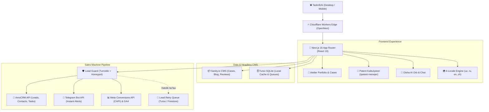

<div align="center">

# ⚡ Jon Branding — Sales Machine Web Platform

**Markaziy Osiyo brend-agentligi uchun premium, yuqori konversiyali veb-platforma.**

[](https://github.com/baxtiyorjongaziyev/jonbranding-web/actions/workflows/test.yml)
[](https://github.com/baxtiyorjongaziyev/jonbranding-web/actions/workflows/codeql.yml)
[](https://github.com/baxtiyorjongaziyev/jonbranding-web/actions/workflows/security-audit.yml)
[](https://jonbranding.uz)
[](https://nextjs.org/)
[](https://react.dev/)
[](https://www.typescriptlang.org/)
[](https://tailwindcss.com/)
[](https://sanity.io)
[](https://workers.cloudflare.com/)
[](LICENSE)

[jonbranding.uz](https://jonbranding.uz) • [Live Production](https://www.jonbranding.uz) • [Hujjatlar](docs/) • [Hissa Qo'shish](CONTRIBUTING.md)

</div>

---

## 📖 Loyiha Haqida

**jonbranding-web** — [Jon Branding](https://jonbranding.uz) agentligining mijozlar yuzi va konversiya dvigateli ("Sales Machine"). Sayt agentlik biznesining markaziy operatsion tizimi bo'lmish **oisha-os** bilan uzviy integratsiyalashgan holda ishlaydi.

Platforma AWWWARDS darajasidagi editorial estetika, to'liq 4 tilli lokalizatsiya (O'zbek, Rus, Ingliz, Xitoy), interaktiv patent kalkulyatori va uzluksiz ishlovchi mustahkam lid-intake tizimiga ega.

---

## 🏛️ Tizim Arxitekturasi

Platforma Edge-first arxitekturasi asosida qurilgan bo'lib, har bir lidning yo'qolmasligini kafolatlovchi ko'p bosqichli navbat tizimiga ega:



---

## ✨ Asosiy Imkoniyatlar (Key Features)

### 1. 🎨 Atelier Portfolio & Keyslar Tizimi
- Jurnal estetikasi (Editorial craft), nafis tipografiya (`Instrument Serif`) va monoxromatik struktura.
- Sanity CMS dan dinamik keys yuklash, toifalar bo'yicha tezkor filtrlash va zaxira keyslar tizimi.

### 2. 📐 Patent & Savdo Belgisi Kalkulyatori
- `/xizmatlar/patent-kalkulyatori` va sotuv jamoasi uchun maxsus `/patent-menejer` portali.
- Davlat bojlari, xalqaro sinflar (MKTU) va agentlik xizmatlarini real vaqt rejimida shaffof hisoblash.
- Bir tugma bilan mijozga rasmiy hisob-kitob kartochkasini ulashish.

### 3. 🔮 Oisha AI Assistant & FoxUI Orb
- Siri va zamonaviy AI interfeyslaridan ilhomlangan dinamik holatli FoxUI Orb (`idle`, `thinking`, `talking`).
- Tashrifchilar bilan o'zbek va rus tillarida dialog qurish va CRM tizimiga malakali lid uzatish.

### 4. 🌍 4 Tilli Mukammal Lokalizatsiya (Uzbek-First)
- **UZ (Asosiy)**, **RU**, **EN**, **ZH** — barcha 4 tilda 1330+ ta kalit to'liq paritetda sinxronlashtirilgan.
- Avtomatik til aniqlash, cookie eslab qolish va kanonik URL boshqaruvi.

### 5. 🛡️ Mustahkam Lid Intake & Zero-Drop Kafolati
- Bot va spamdan himoya (Cloudflare Turnstile + in-memory / Firestore rate limiting + honeypot).
- Agar AmoCRM tarmog'ida uzilish bo'lsa, lidlar darhol mahalliy Turso yoki Firestore navbatiga olinadi va avtomatik qayta yuboriladi.

---

## 🛠️ Texnologiyalar Steki

| Qatlam | Texnologiya | Tavsif |
|---|---|---|
| **Framework** | Next.js 16.4.5 (App Router) | Server Components, Turbopack, Standalone & Worker output |
| **Runtime** | React 19.2 + Node.js 22 LTS | Zamonaviy React primitives, Action hooks |
| **Styling** | Tailwind CSS + ShadCN UI | 60-30-10 rang arxitekturasi, dark/light tokenlar |
| **Edge Hosting** | Cloudflare Workers (OpenNext) | Global sub-millisekund javob tezligi |
| **Headless CMS** | Sanity.io Studio v3 | Portfolio, mijozlar fikrlari va postlar boshqaruvi |
| **Integrations** | AmoCRM, Meta CAPI, Telegram, GA4 | Markaziy savdo va analitika integratsiyalari |
| **Database/Cache** | Turso (libSQL) & Cloud Firestore | Lidlar zaxirasi, so'rovlar limiti va tokenlar ombori |
| **Testing** | Vitest, Testing Library, Playwright | 74 ta test fayli, 470+ unit va integratsion testlar |

---

## 🚀 O'rnatish va Ishga Tushirish

### 1. Reponi klonlash:
```bash
git clone https://github.com/baxtiyorjongaziyev/jonbranding-web.git
cd jonbranding-web
```

### 2. Qaramliklarni o'rnatish:
```bash
npm install
```

### 3. Muhit o'zgaruvchilari:
`.env.example` dan `.env.local` nusxasini yarating va kerakli kalitlarni kiriting:
```bash
cp .env.example .env.local
```

### 4. Lokal serverni ishga tushirish:
```bash
# Standart port: http://localhost:9002
npm run dev
```

---

## 🧪 Sifat Nazorati va Sinovlar (Quality Harness)

Loyiha qat'iy sifat nazorati (Quality Harness) tizimiga ega. Har qanday o'zgarish quyidagi buyruqlar orqali tekshiriladi:

```bash
# Tezkor tekshiruv (i18n pariteti + kod standartlari + Vitest 470+ test)
npm run verify:fast

# To'liq sifat tekshiruvi (Agent Harness)
npm run verify

# TypeScript tekshiruvi (Strict mode, 0 errors)
npm run typecheck

# Linter tekshiruvi (ESLint)
npm run lint

# Ishlab chiqarish build tekshiruvi
npm run build

# Xavfsizlik auditi (0 ta high/critical zaiflik)
npm audit --audit-level=high --omit=dev
```

---

## 📂 Loyiha Tuzilishi

```
jonbranding-web/
├── .github/                  # GitHub Actions CI/CD, issue & PR shablonlari
│   ├── ISSUE_TEMPLATE/       # Bug report, Feature request, Task shablonlari
│   └── workflows/            # CI (test, build), CodeQL, Security Audit, Cloudflare deploy
├── docs/                     # Arxitektura, narxlar, dev log va audit hujjatlari
├── public/                   # Statik resurslar, piktogrammalar va rasmlar
├── src/
│   ├── app/                  # Next.js 16 App Router sahifalari va API endpointlari
│   │   ├── [lang]/           # Ko'p tilli dinamik marshrutlar (uz, ru, en, zh)
│   │   └── api/              # AmoCRM, Oisha, CAPI, Webhook va Cron endpointlari
│   ├── components/           # UI komponentlar, atelier bo'limlari va layout
│   ├── hooks/                # React custom hooklari
│   ├── lib/                  # Yordamchi modullar, analitika, narxlar va integratsiyalar
│   ├── locales/              # 4 tildagi i18n JSON lug'atlari (uz, ru, en, zh)
│   └── sanity/               # Sanity CMS sxemalari va mijoz sozlamalari
└── wrangler.jsonc            # Cloudflare Workers va OpenNext konfiguratsiyasi
```

---

## 🛡️ Xavfsizlik va Maxfiylik

Platforma xavfsizligi doimiy monitoring qilinadi. Xavfsizlik zaifliklarini bildirish tartibi bilan [SECURITY.md](SECURITY.md) faylida tanishishingiz mumkin.

---

## 📄 Litsenziya

Jon Branding agentligining xususiy intellektual mulki hisoblanadi. Barcha huquqlar himoyalangan.
Batafsil ma'lumot uchun [LICENSE](LICENSE) fayliga qarang.
